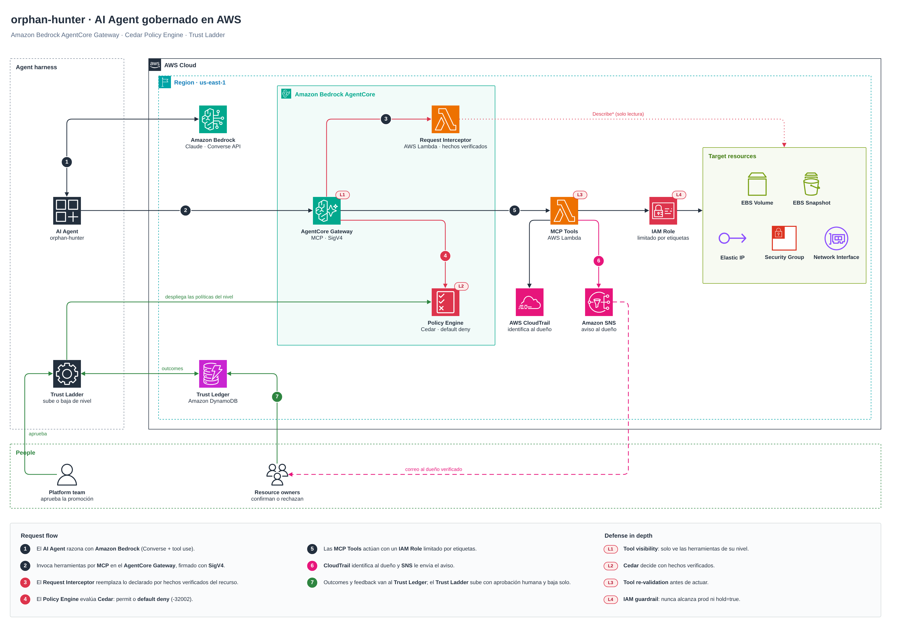
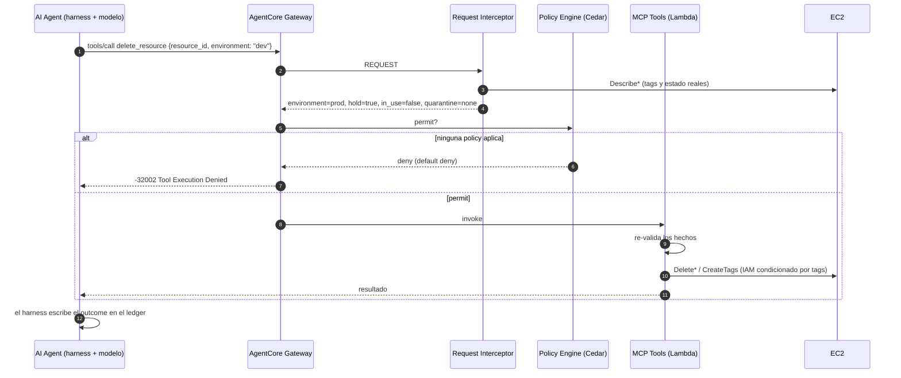
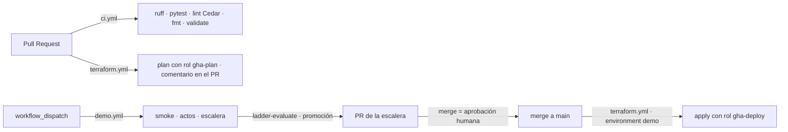

# Arquitectura

Fuente editable: [`architecture.drawio`](architecture.drawio). Si lo cambias, exporta de nuevo `img/architecture.png`
en el mismo PR.

## Una llamada gobernada

El mismo interceptor corrige `notify_owner`: el agente propone a quién avisar y la plataforma enruta al `owner` real
del recurso (o a "plataforma").

## Defense in depth

| Capa | Dónde | Qué impide |
|---|---|---|
| L1 · Tool visibility | Gateway | `tools/list` solo muestra lo que permite el nivel actual |
| L2 · Cedar sobre hechos verificados | Policy Engine | actuar fuera del nivel o saltarse el proceso |
| L3 · Tool re-validation | Lambda | que un error de Cedar termine en una acción |
| L4 · IAM guardrail | Rol de la Lambda | tocar prod o `hold=true`, o reescribir `env`/`hold` (`aws:TagKeys`) |

## Trust Ladder

| Nivel | Herramientas | Acción máxima |
|---|---|---|
| 0 | `list_candidates`, `find_probable_owner`, `notify_owner` | avisar |
| 1 | + `quarantine_resource` | cuarentena reversible |
| 2 | + `delete_resource` | eliminar, solo si la cuarentena venció o el dueño liberó |

- **Sube** con evidencia humana (`confirmed`): 3 confirmaciones → propuesta → aprobación humana.
- **Baja** sola con un `blocked` o un `rejected`.
- El nivel vive en `terraform.tfvars`. Cambiarlo crea o destruye policies Cedar (`-target`, ~1 min); el gateway no se
  toca.
- El ledger lo escriben el harness y las personas, nunca el modelo.

## Módulos

| Módulo | Entradas principales | Salidas |
|---|---|---|
| `lambda-function` | `name`, `source_dir`, `policy_json` (obligatoria), `extra_files` | `function_arn`, `role_arn`, `log_group_name` |
| `governed-gateway` | `targets`, `governed`, `interceptor_lambda_arn`, `policy_engine_mode` | `gateway_arn`, `gateway_url`, `policy_engine_id` |
| `trust-ladder` | `ladder`, `policies_dir`, `level`, `gateway_arn` | `active_policies`, `ledger_table` |

El contrato con Python son los outputs de `examples/orphan-hunter`; hay una prueba que falla si Python lee un output
que no existe.

## Entrega

- Sin access keys en GitHub: OIDC con dos roles. `gha-plan` (ReadOnly) para PRs y `gha-deploy` solo desde el
  environment `demo`, que solo acepta la rama `main`.
- Estado en S3 cifrado, versionado y con lock nativo (`use_lockfile`).
- Subir de nivel es un PR que alguien aprueba. Bajar se aplica en el mismo run y se publica directo en `main`.
